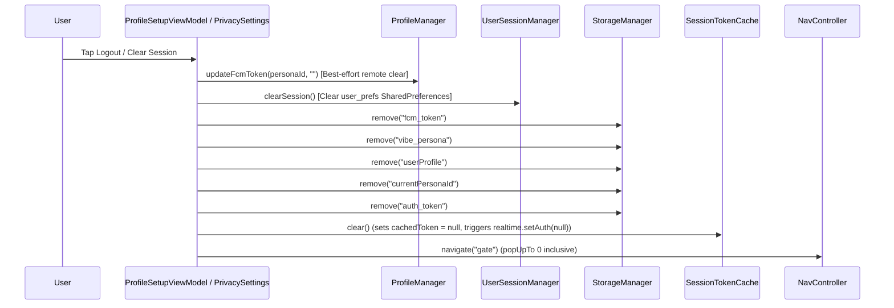

# Phase 2C-2 Preflight Report — Android Auth Session Lifecycle Audit

## Executive Summary

Phase 2C-1 successfully transitioned the backend and verification path to issue Supabase Auth ES256/HS256 JWTs via the `verify-passkey` Edge Function (password grant against Supabase Auth). The Android app currently obtains this JWT upon successful login at the [GateScreen](file:///C:/Baroness_Core/Baroness-kt/app/src/main/java/com/baroness/app/screens/GateScreen.kt) via [AuthManager](file:///C:/Baroness_Core/Baroness-kt/app/src/main/java/com/baroness/app/modules/AuthManager.kt), saves it to DataStore (`baroness_prefs` under key `"auth_token"`), and propagates it via [SessionTokenCache](file:///C:/Baroness_Core/Baroness-kt/app/src/main/java/com/baroness/app/auth/SessionTokenCache.kt), [AuthTokenInterceptor](file:///C:/Baroness_Core/Baroness-kt/app/src/main/java/com/baroness/app/auth/AuthTokenInterceptor.kt), and `SupabaseConfig` token callbacks.

However, **Phase 2C-2 Preflight Audit reveals critical gaps in session lifecycle management**:
1. **Token Expiry Ignored**: The access token has a 7-day lifetime (`expires_in = 604800`), but the client completely ignores `refresh_token` and `expires_in` returned by `verify-passkey`. No absolute expiry is computed, stored, or checked.
2. **No Token Refresh Mechanism**: When the 7-day token expires, requests fail with HTTP 401 Unauthorized (`PGRST301`), leaving the user stranded on an empty/broken dashboard with no automatic recovery or redirect to the Gate.
3. **Incomplete Logout Teardown**: Local DataStore session keys and `SessionTokenCache` are cleared, but Room database tables (`messages`, `wishlist_items`, etc.) and WorkManager background jobs (`ChatSyncWorker`, `SyncWorker`) persist across logout. Furthermore, server-side session revocation (`POST /auth/v1/logout`) is never invoked.
4. **Background Worker Risk**: Enqueued WorkManager background workers continue running post-logout with stale or null tokens.
5. **Realtime Re-auth Timing**: Realtime `setAuth(null)` during logout runs asynchronously without synchronization guarantees before WebSocket reconnections.

---

## 1. Login & Token Storage Map

| Response Field from `verify-passkey` | Parsed in `AuthManager.kt`? | Stored / Handled in Client? | Destination / Key Name |
| :--- | :--- | :--- | :--- |
| `token` (Access Token) | **Yes** (`jsonObj.optString("token")`) | **Yes** | DataStore `"auth_token"` & `SessionTokenCache` in-memory cache |
| `refresh_token` | **No** (Ignored) | **No** (Discarded) | None |
| `expires_in` | **No** (Ignored) | **No** (Discarded) | None |
| `currentPersonaId` | **Yes** (`jsonObj.optString("currentPersonaId")`) | **Yes** | DataStore `"currentPersonaId"` & `UserSessionManager` (`user_prefs` SharedPreferences) |
| `userProfile` | **Yes** | **Yes** | DataStore `"userProfile"` (Serialized JSON) |

---

## 2. Logout Flow Diagram



**Observations on Logout:**
1. **No Server Revocation**: `POST /auth/v1/logout` is never called.
2. **Room DB Persistent**: Local SQLite tables (`messages`, `wishlist_items`, `wishlist_reactions`, `wishlist_ratings`, `sync_queue`) remain intact on disk.
3. **WorkManager Jobs**: Enqueued `ChatSync` and `SyncWorker` jobs are not cancelled.

---

## 3. Failure Behavior Findings

1. **Access Token Expired (HTTP 401)**:
   - `AuthTokenInterceptor` attaches the expired JWT anyway.
   - PostgREST returns HTTP 401 (`PGRST301`).
   - Repositories catch the exception, log an error, and fail silently or show empty lists.
   - WorkManager workers retry indefinitely with exponential backoff using the expired token.
2. **Cold Start After 7+ Days**:
   - `currentPersonaId` is present in DataStore, so the app bypasses [GateScreen](file:///C:/Baroness_Core/Baroness-kt/app/src/main/java/com/baroness/app/screens/GateScreen.kt) and opens [DashboardScreen](file:///C:/Baroness_Core/Baroness-kt/app/src/main/java/com/baroness/app/screens/DashboardScreen.kt).
   - All network calls and Realtime subscriptions fail with 401 Unauthorized. The user sees an unresponsive, empty UI with no redirect to login.
3. **Refresh Token Reuse Violation (>10s window)**:
   - With Supabase `enable_refresh_token_rotation = true` and `refresh_token_reuse_interval = 10`, using a rotated refresh token twice revokes the entire refresh token family. Without client-side error handling (catching `invalid_grant` and forcing re-authentication), the app would permanently wedge in a 401 loop.
4. **Offline at Cold Start**:
   - App loads successfully using cached local Room DB data and DataStore preferences. Network calls fail gracefully via try/catch; offline mode functions correctly.

---

## 4. Background / Realtime Interaction Findings

- **Background Workers**: [ChatSyncWorker](file:///C:/Baroness_Core/Baroness-kt/app/src/main/java/com/baroness/app/workers/ChatSyncWorker.kt) and [SyncWorker](file:///C:/Baroness_Core/Baroness-kt/app/src/main/java/com/baroness/app/workers/SyncWorker.kt) run in isolated WorkManager scopes (`Dispatchers.IO`) and read tokens via `SessionTokenCache`. They survive logout if enqueued.
- **Realtime WebSocket Reconnection**: [SessionTokenCache.clear()](file:///C:/Baroness_Core/Baroness-kt/app/src/main/java/com/baroness/app/auth/SessionTokenCache.kt) calls `realtime.setAuth(null)` asynchronously. There is no synchronization barrier preventing WebSocket reconnection attempts with stale tokens during logout transitions.

---

## 5. Refresh Token Availability

- **Confirmed / Unblocked**: The deployed `verify-passkey` Edge Function explicitly returns `refresh_token` and `expires_in` (`604800`).
- Phase 2C-2 is fully unblocked to parse and store `refresh_token` and compute absolute expiration (`System.currentTimeMillis() + (expires_in * 1000L)`).

---

## 6. Single-Flight Scope Analysis

1. **Trigger Paths**: Interceptor (401 response), proactive expiration check, Realtime reconnect, WorkManager worker.
2. **Scope Boundaries**: `SessionTokenCache` and repositories operate in independent coroutine scopes.
3. **Recommended Mutex Location**: A centralized `AuthTokenManager` or extension on `SessionTokenCache` utilizing a coroutine `Mutex` (`kotlinx.coroutines.sync.Mutex`) and `CompletableDeferred` to ensure single-flight refresh execution across concurrent callers.

---

## 7. Server-Side Logout Plan Inputs

- **Endpoint**: `POST /auth/v1/logout`
- **Headers**: `apikey: SUPABASE_ANON_KEY`, `Authorization: Bearer <access_token>`, `Content-Type: application/json`
- **Capability**: Easily executable via OkHttp (`SupabaseConfig.client`).
- **Policy**: Must be **best-effort** (`try/catch`) so network failures or expired tokens never block local session teardown.

---

## 8. Feature Impact Matrix

| Feature | Reads Token? | Affected by Expiry? | Affected by Logout? |
| :--- | :--- | :--- | :--- |
| HumanChat send/receive | Yes (`SessionTokenCache`) | Yes (401 on REST/Realtime) | Yes (clears cache & persona) |
| Realtime sync pipe | Yes (`Realtime.setAuth`) | Yes (WebSocket auth failure) | Yes (channel teardown) |
| Friday AI chat | Yes (`AuthTokenInterceptor`) | Yes (401 on Edge/REST) | Yes |
| Wishlist | Yes (`WishlistApi` / `SupabaseConfig`) | Yes (401 on sync/realtime) | Yes |
| Profile / Avatar upload | Yes (`ProfileManager`) | Yes (401 on Storage/REST) | Yes |
| FCM Token Registration | Yes (`ProfileManager`) | Yes (401 on PATCH) | Yes |
| PhestyDrop release check | Yes (`PhestyDropManager`) | No (public read table) | No |

---

## 9. Recommended Implementation Scope for Phase 2C-2

### Must-Fix (Critical for Sessions > 7 Days)
1. **Store Refresh Token & Expiry**: Parse `refresh_token` and `expires_in` in `AuthManager` and save them to DataStore (`"refresh_token"`, `"token_expires_at"`).
2. **Proactive & Reactive Token Refresh**: Implement token refresh logic (`POST /auth/v1/token?grant_type=refresh_token`) with a single-flight coroutine `Mutex`.
3. **401 Interceptor Handling**: Update `AuthTokenInterceptor` (or add an OkHttp `Authenticator`) to intercept 401 responses, refresh the token, and retry the request transparently.
4. **Session Expiry Routing / Re-Auth**: When refresh fails (e.g. invalid grant), clear session and force navigation back to [GateScreen](file:///C:/Baroness_Core/Baroness-kt/app/src/main/java/com/baroness/app/screens/GateScreen.kt).

### Should-Fix (Correctness & Edge Cases)
1. **Server-Side Revocation**: Implement best-effort `POST /auth/v1/logout` during logout.
2. **Comprehensive Local Teardown on Logout**: Clear Room database tables (`messages`, `wishlist_items`, etc.) and cancel enqueued WorkManager jobs (`WorkManager.getInstance(context).cancelAllWork()`) on logout.
3. **Realtime Disconnection**: Explicitly disconnect Realtime client (`supabase.realtime.disconnect()`) on logout before clearing token cache.

### Defer
1. Multi-device session management UI.
2. Biometric prompt gating for session restoration.

---

## 10. Open Questions

1. Should local Room DB chat and wishlist caches be completely wiped on logout, or preserved for the next login? *(Current recommendation: wipe on explicit logout to prevent data leakage between personas on shared devices).*
2. Should token refresh happen proactively (e.g. when app resumes and token is within 1 hour of expiry) or reactively on HTTP 401? *(Recommended: both proactive on resume and reactive on 401 with single-flight mutex).*

---

## Phase 2C-2 Follow-Up — Engine and Callback Investigation

### 1. Engine Determination & OkHttp Authenticator Feasibility
- **a) Does supabase-kt's PostgREST/Storage traffic flow through `SupabaseConfig.client`?**
  **No.** `SupabaseConfig.client` is a separate `OkHttpClient` instance instantiated explicitly in [SupabaseConfig.kt](file:///C:/Baroness_Core/Baroness-kt/app/src/main/java/com/baroness/app/config/SupabaseConfig.kt#L25-L33) for manual REST/Storage calls (`AuthManager`, `ProfileManager`, `PhestyDropManager`), equipped with `AuthTokenInterceptor`. `supabase-kt` (`Postgrest`, `Storage`, `Realtime`) utilizes its own internal Ktor client engine (backed by `ktor-client-okhttp` dependency) and **completely bypasses** `SupabaseConfig.client` and `AuthTokenInterceptor`.
- **b) Can we inject an OkHttp Authenticator into supabase-kt's Ktor engine?**
  While `ktor-client-okhttp` is on the classpath, `supabase-kt` initializes its own Ktor client internally during `createSupabaseClient(url, key)`. Without configuring custom Ktor engine settings via `createSupabaseClient` (e.g. configuring the Ktor HttpClient engine), an OkHttp-level Authenticator added to `SupabaseConfig.client` will **not** intercept or protect `supabase-kt` traffic.
- **c) Correct mechanism for handling 401-triggered refresh for supabase-kt requests:**
  Because `supabase-kt` evaluates the `accessToken` callback for every request and WebSocket connection, the correct architecture is a **proactive token-refresh check inside the `accessToken` provider callback** (and/or a Ktor HTTP client interceptor), rather than relying solely on an OkHttp Authenticator.

### 2. `accessToken` Callback Signature
- In `supabase-kt` 3.1.1 (`io.github.jan.supabase.SupabaseClient`), the `accessToken` parameter in `createSupabaseClient` is a suspend function block:
  `var accessToken: suspend () -> String? = { null }`.
- **Evidence**: As configured in [SupabaseConfig.kt](file:///C:/Baroness_Core/Baroness-kt/app/src/main/java/com/baroness/app/config/SupabaseConfig.kt#L19):
  ```kotlin
  accessToken = { SessionTokenCache.getToken() }
  ```
  Because Kotlin allows passing a synchronous lambda to a suspend function type when no suspension point is required inside the lambda, this compiles successfully. However, because it accepts a suspend block (`suspend () -> String?`), we can upgrade `accessToken` to an asynchronous block that checks token expiration, executes a single-flight mutex refresh if expired, and returns the valid token.

### 3. `SessionTokenCache.init` Startup Order
- **a) Where called:** `MainApplication.onCreate()` ([MainApplication.kt](file:///C:/Baroness_Core/Baroness-kt/app/src/main/java/com/baroness/app/MainApplication.kt#L23)).
- **b) Guaranteed population before first request?** **No.** `SessionTokenCache.init` launches an asynchronous coroutine collecting `storageManager.getStringFlow("auth_token")` on `Dispatchers.IO`. On cold start, `cachedToken` is initially `null` until DataStore emits its value.
- **c) Race window:** There is a narrow cold-start race window where network requests or Realtime subscriptions fired immediately upon app launch before DataStore emission complete may observe a `null` token or use an unauthenticated state.

### 4. Response Parsing Library and Refresh Mapping Plan
- **a) Library used:** Manual `org.json.JSONObject` / `org.json.JSONArray`.
- **b) Current parsing code in `AuthManager.kt`**:
  ```kotlin
  val token = jsonObj.optString("token", null)
  ```
- **c) Refresh response mapping**: Supabase Auth refresh endpoint (`POST /auth/v1/token?grant_type=refresh_token`) returns standard OAuth2/Supabase Auth JSON where the access token field is named `"access_token"` (whereas `verify-passkey` returned `"token"`). Therefore, parsing logic must check `jsonObj.optString("access_token", jsonObj.optString("token", null))`.

### 5. Refresh Response Shape (`POST /auth/v1/token?grant_type=refresh_token`)
- **a) Field names**: `access_token`, `token_type`, `expires_in`, `refresh_token`, `user`, etc.
- **b) `expires_in` present?** Yes (integer seconds, e.g., `604800`).
- **c) `refresh_token` returned?** Yes (rotated refresh token string).
- **d) Access token field name**: `"access_token"`.

### 6. Revised "Must-Fix" List for Phase 2C-2 (Reflecting Actual Engine Architecture)
1. **Store Refresh Token & Expiry**: Parse `refresh_token` and `expires_in` from `verify-passkey` (and token refresh responses) in `AuthManager`, storing `"refresh_token"` and `"token_expires_at"` (absolute epoch millis) in DataStore.
2. **Centralized Token Refresh Manager (`AuthManager` / `SessionTokenCache`)**: Implement a thread-safe coroutine `Mutex` (`kotlinx.coroutines.sync.Mutex`) and single-flight refresh function calling `POST /auth/v1/token?grant_type=refresh_token`.
3. **Smart Asynchronous `accessToken` Callback**: Update `SupabaseConfig.kt` to define `accessToken` as a suspend block that checks expiration, triggers single-flight refresh if expired, updates DataStore/Cache, and returns the valid token for all `supabase-kt` operations.
4. **Direct OkHttp Interceptor Refresh**: Update `AuthTokenInterceptor` (used by `SupabaseConfig.client`) to also invoke the token refresh manager on HTTP 401 responses.
5. **Session Expiry & Re-Auth Routing**: Catch `invalid_grant` / unrecoverable refresh failures, clear local session state, and force navigation back to `GateScreen`.
