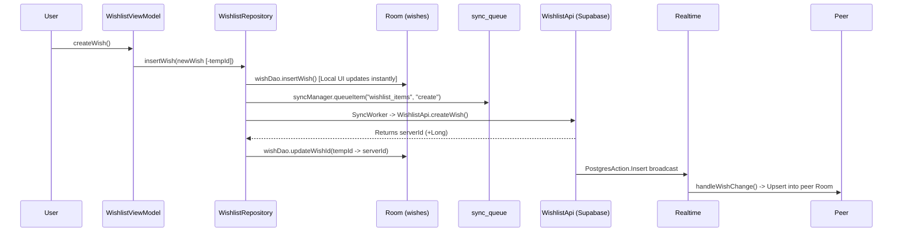

# Wishlist Feature Audit — Full-Stack Flows and Traces

## 1. End-to-End Wish Creation Trace

1. **ViewModel Entry Point**:
   - User types text and taps cast button in `WishlistScreen.kt`, invoking `WishlistViewModel.createWish(text, date)` (`WishlistViewModel.kt`, line 157).
2. **Repository Write & Local Persistence**:
   - `WishlistViewModel` generates a negative temporary ID (`val tempId = -System.currentTimeMillis()`) and calls `WishlistRepository.insertWish(newWish)` (`WishlistRepository.kt`, line 462).
   - `WishlistRepository` inserts a `WishEntity` into Room via `wishDao.insertWish(entity)` (`WishDao.kt`, line 18) with `syncStatus = "pending_create"`.
3. **Queueing for Sync**:
   - `WishlistRepository.insertWish` serializes the wish payload to JSON and calls `syncManager.queueItem(tableName = "wishlist_items", recordId = wish.id.toString(), operation = "create", payload = payload, localTempId = wish.id)` (`SyncManager.kt`, line 30).
   - Calls `syncNow()`, which enqueues a `SyncWorker` job via WorkManager (`WishlistRepository.kt`, line 542).
4. **Worker Processing & API Call**:
   - `SyncWorker` (`SyncWorker.kt`) calls `SyncManager.processQueue()`, which reads pending queue items (`SyncManager.kt`, line 42).
   - `SyncManager.processWishItem` executes `WishlistApi.createWish(...)` (`WishlistApi.kt`, line 50), performing an HTTP POST/upsert to Supabase `wishlist_items` via PostgREST.
5. **ID Remap Transaction**:
   - When `WishlistApi.createWish` returns the server-assigned `result.id` (positive Long), `SyncManager` calls `wishDao.updateWishId(oldTempId = tempId, newServerId = serverId)` (`WishDao.kt`, line 39).
   - *Confirmed Issue*: `updateWishId` updates only the `wishes` table primary key; child records in `reactions` and `ratings` referencing the negative temp `wishId` are not remapped.
6. **Realtime Broadcast & Peer Handling**:
   - Supabase broadcasts an INSERT event over the Realtime publication (`wishlist_items`).
   - The peer device receives the event via `WishlistRepository.handleWishChange()` (`WishlistRepository.kt`, line 305), which upserts the incoming remote entity into local Room and triggers an in-app notification banner.

---

## 2. Shorter Feature Treatments

- **Reaction Upsert**:
  - Invoked via `WishlistRepository.saveReaction(wishId, personaId, emoji)` (`WishlistRepository.kt`, line 521). Upserts locally into `reactions` DAO, queues operation in `sync_queue` for table `wishlist_reactions` with conflict target `(wish_id, persona_id)`, and executes `WishlistApi.upsertReaction` via `SyncWorker`. Realtime broadcast updates peer.
- **Rating Upsert**:
  - Invoked via `WishlistRepository.saveRating(wishId, personaId, rating)` (`WishlistRepository.kt`, line 534). Upserts locally into `ratings` DAO, queues operation in `sync_queue` for table `wishlist_ratings` with conflict target `(wish_id, persona_id)`, and executes `WishlistApi.upsertRating` via `SyncWorker`. Realtime updates peer.
- **Delete Wish**:
  - Invoked via `WishlistRepository.deleteWish(wishId)` (`WishlistRepository.kt`, line 506). Deletes locally from `wishes`, `reactions`, and `ratings` DAOs. Queues a `"delete"` operation in `sync_queue` and executes `WishlistApi.deleteWish` via `SyncWorker`. Realtime broadcast (`PostgresAction.Delete`) propagates deletion to peer.
- **Status Transition (planning -> dusted)**:
  - Invoked via `WishlistViewModel.dustWish(wishId)` -> `WishlistRepository.updateWishStatus(wishId, "dusted")` (`WishlistRepository.kt`, line 515). Updates local Room status, queues an `"update"` operation in `sync_queue`, and executes `WishlistApi.updateWish` via `SyncWorker`. Realtime broadcasts update to peer.

---

## 3. Creation Flow Sequence Diagram

